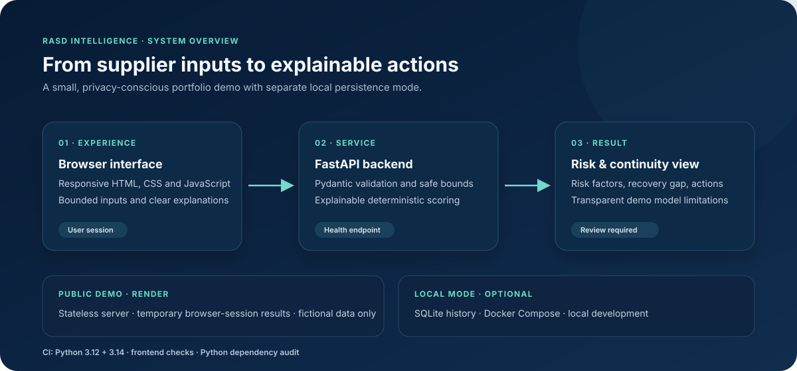

# RASD Intelligence

**Supplier risk and business continuity, made easier to explain.**

[](https://github.com/layansaff/rasd-intelligence-demo/actions/workflows/ci.yml) · [Open the live demo](https://rasd-intelligence-demo.onrender.com/ui) · [العربية](README.ar.md)

RASD Intelligence is a portfolio project that turns supplier disruption inputs into a structured, explainable risk assessment. It combines a responsive browser interface with a validated FastAPI backend and a transparent rules-based scoring model.

> **Demo:** [rasd-intelligence-demo.onrender.com/ui](https://rasd-intelligence-demo.onrender.com/ui). The public version is intentionally stateless: visitor assessments are not saved on the server. Use fictional data only.

> **Decision-use notice:** The score is a deterministic, preliminary rules-based estimate. It has not been validated against operational loss data, and it must not be used as the sole basis for supplier approval, insurance, lending, or other consequential decisions. A qualified reviewer must assess the result and its assumptions.



## Project at a glance

| | |
| --- | --- |
| **Problem** | Make supplier disruption exposure and recovery readiness easier to assess and communicate. |
| **Approach** | Validate bounded inputs, show the factors behind a deterministic score, and connect findings to continuity actions. |
| **Stack** | HTML, CSS, JavaScript, Python, FastAPI, Pydantic, SQLite, Docker, GitHub Actions, and Render. |
| **Deployment** | Public portfolio demo with server-side storage disabled; local mode supports SQLite assessment history. |

## What it demonstrates

- A responsive risk assessment workflow with explicit input bounds and factor-by-factor explanations.
- Inherent and residual risk scores, recovery gap, risk bands, and practical recommendations.
- A FastAPI service with strict request validation, a 16 KiB request-body limit, health checks, and security headers.
- Two deployment modes: privacy-focused stateless public demo and local SQLite-backed prototype.
- Docker Compose, non-root container execution, API and frontend checks, Python-version CI, and dependency auditing.

## Run locally

Requires Python 3.10 or newer.

```powershell
python -m venv .venv
.\.venv\Scripts\Activate.ps1
python -m pip install -r requirements-dev.txt
Copy-Item .env.example .env
python -m uvicorn backend.main:app --env-file .env --host 127.0.0.1 --port 8000
```

Open <http://127.0.0.1:8000/>; the root address redirects directly to the web interface. API documentation is at <http://127.0.0.1:8000/docs> and health is at <http://127.0.0.1:8000/health>.

Assessment history is stored in `data/rasd.sqlite3` by default. Keep this file private and include it in your backup routine. Override the location with `RASD_DATABASE_PATH`.

If the frontend is hosted separately, set `RASD_CORS_ORIGINS` to a comma-separated list of exact trusted origins, including scheme and port. The default allows only the two common local development origins on port 5500. Do not use a wildcard origin with sensitive or internal data.

## Run tests

```powershell
python -m pytest -q
```

Tests use temporary SQLite databases and do not modify the default application data file.

Continuous integration runs the same test suite and a known-vulnerability audit of Python dependencies on every push and pull request. Dependabot checks Python packages and GitHub Actions weekly and proposes updates as pull requests.

## Run with Docker Compose

```powershell
docker compose up --build
```

The service is bound to `127.0.0.1:8000`, and Compose stores database files in the named `rasd-data` volume. The container runs as a non-root user and includes a health check. Back up the volume before replacing or moving the deployment.

## Public portfolio demo on Render

`render.yaml` defines a free web service in Frankfurt. `.python-version` keeps Render on Python 3.14, and CI checks the API on both Python 3.12 and 3.14. It enables `RASD_DEMO_MODE=true`: the API still calculates assessments, but it does not create a database or store visitor assessments on the server, and it disables API documentation. Each visitor's result and history are temporary in that browser session. Use fictional information only; do not enter real supplier or personal data.

1. Push the project to a GitHub repository. Do not commit `.env`, the `data` directory, or database files.
2. In Render, create a **Blueprint** and connect that repository. Render reads the service configuration from `render.yaml`.
3. After deployment, open the `onrender.com` URL directly; it redirects to the interface. Run an assessment in a private browser window.
4. Add the demo URL to LinkedIn only after confirming `/health` reports `demo_mode: true` and `storage: disabled`, and `/docs` is unavailable.

Render's free web services spin down after 15 minutes without traffic, and the first request after idle can take about a minute to wake the service. Their local filesystem is ephemeral and is cleared on restarts, so this setup is for a portfolio demo, not operational data or production use.

## API

| Method | Path | Purpose |
| --- | --- | --- |
| `GET` | `/health` | API and database health |
| `POST` | `/analyze-risk` | Validate and score an assessment; persistence is enabled only in local mode |
| `GET` | `/assessments?limit=50&offset=0` | Page through saved assessments |
| `GET` | `/assessments/summary` | Exact aggregate totals across all saved assessments |
| `DELETE` | `/assessments` | Permanently clear saved assessments |
| `GET` | `/docs` | Interactive OpenAPI documentation |
| `GET` | `/ui` | Web application |

`POST /analyze-risk` rejects unknown fields, numeric strings, fractions, and values outside the documented limits. Recovery hours must be an integer from 0 through 8760; required recovery hours must be an integer from 1 through 8760.

The API rejects request bodies larger than 16 KiB before parsing them.

## Scoring method

Dimension values are configuration choices for a demonstration, not calibrated probabilities:

- Impact: low 25, medium 55, high 90.
- Disruption likelihood: low 20, medium 55, high 90.
- Supplier dependency: low 20, medium 55, high 90.
- Controls: strong 20, adequate 50, weak 90.
- Recovery exposure: 15 when at or below target; 35 up to 1.5× target; 55 up to 2×; 80 up to 4×; otherwise 100.
- Inherent score weights: impact 40%, likelihood 30%, recovery 20%, dependency 10%.
- Residual score weights: impact 35%, likelihood 25%, recovery 20%, adjusted dependency 10%, controls 10%.
- An available alternative supplier reduces the dependency dimension by 25 points, with a floor of zero.
- Risk bands: low 0–39, medium 40–69, high 70–100.

The organization using this prototype must approve the dimensions, weights, adjustments, thresholds, and recommendations before operational use. No statistical calibration, back-testing, bias review, or independent model validation is included.

## Portfolio notes

See [docs/portfolio-kit.md](docs/portfolio-kit.md) for a concise project brief, a short demo walkthrough, and draft LinkedIn copy. The project is intended to demonstrate product thinking and full-stack implementation; its scoring model is illustrative and is not a validated risk model.

## Security and production boundaries

The default configuration is a **single-machine demonstration**, not a multi-user production service. SQLite is unencrypted by default, and the API does not include user authentication, authorization, tenant isolation, or a tamper-resistant audit trail. Do not expose the default persistent mode to the public internet. The public portfolio mode above intentionally stores no visitor data, but it is still a demo and not for operational use. Production deployment requires an organization-approved identity layer, role-based authorization, encrypted storage and transport, managed secrets, backup/restore exercises, monitoring, retention controls, security review, and model governance.

The sample risk score is not a prediction of loss or a substitute for an organization's formal risk assessment.
